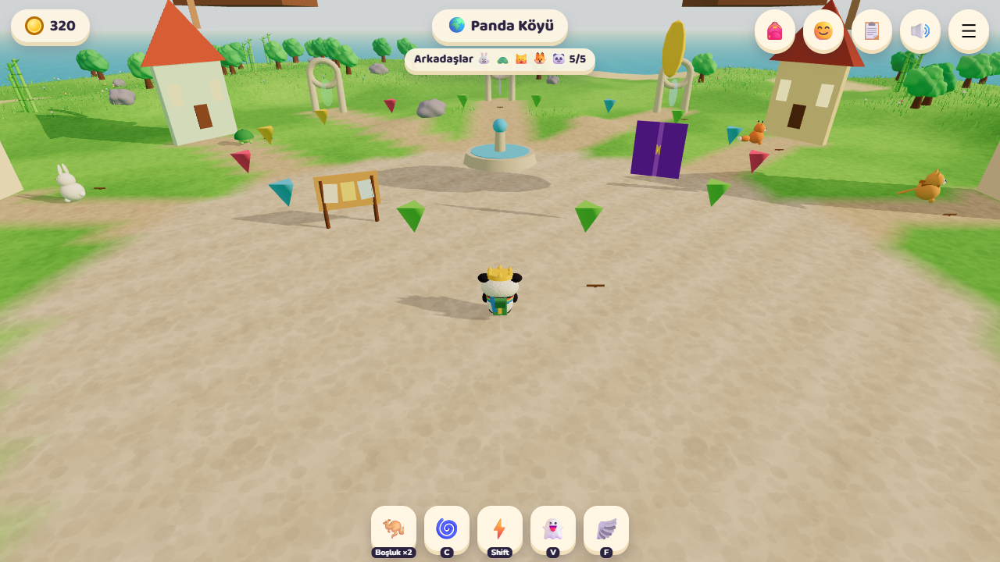
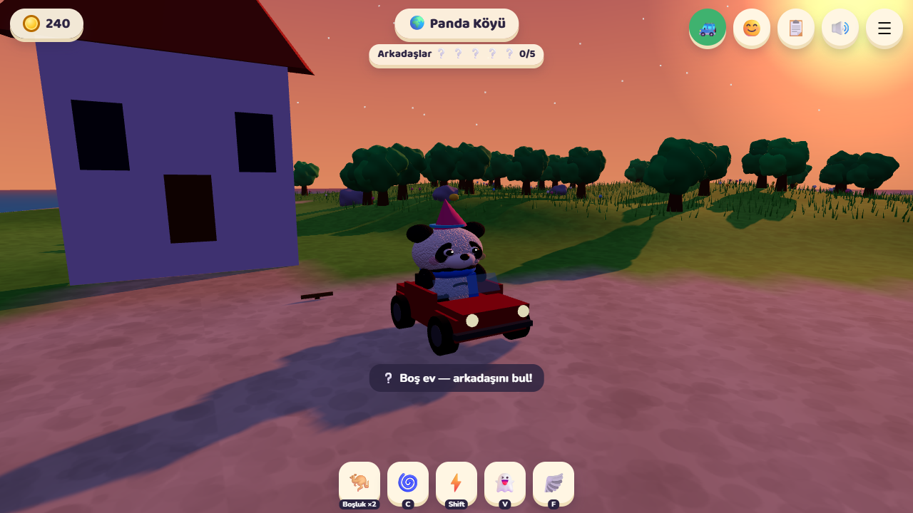

# 🐼 Mochi'nin Panda Köyü

6-15 yaş için tarayıcıda oynanan 3B macera oyunu. Mochi adlı panda, kötü Dev Fare, Kaplan ve Kötü Ayı'nın gizli yerlere hapsettiği arkadaşlarını kurtarır ve Panda Köyü'nü yeniden neşeyle doldurur.



## Özellikler
- 3 açık dünya: Bambu Ormanı, Gizli Mağara, Buzul Dağ (tepeler, çukurlar, çamur, dikenli tuzaklar)
- 5 süper güç: çift zıplama, yuvarlanma, hızlı koşu, görünmezlik, uçma (enerji balonlarıyla uçuş enerjisi dolar)
- Zorunlu maceracı çantası: kaykay, paten, scooter, bisiklet, mini üstü açık araba + yakalama ağı 🕸️ ve yumruk 👊
- Büyük boss'lar: duvara çarptır ya da ağla yakala, sonra vur
- Taş, ağaç ve evlerin içinden geçilmez; köydeki evlere girilir, içinde eşyalar var
- Gizli kulübeler, sihirli perdeler ve gizli hileler (Bug Defteri)
- Günlük görevler, oyun içi para, gardırop, karakter boyutu ayarı (gerçek para ve reklam yok)
- Kutlama efektleri ve "Yuppi!" sesleri
- 15 kişiye kadar çok oyunculu oda (oda kodu), yazılı ve sesli sohbet
- Sabah / akşam modu, düşük kalite seçeneği, küçük kaşif modu
- Kayıt cihazda otomatik tutulur; kısa kod (MOCHI-XXXX-…) ya da paylaşılabilir bağlantıyla başka cihaza taşınır



## Çalıştırma
Derleme gerekmez, düz HTML/CSS/JS'tir.

```bash
node serve.mjs
```

Sonra `http://localhost:3000` adresini aç. 3B kütüphane (three.js) ve PeerJS `js/vendor/` altında yerel durur; yalnızca yazı tipleri ve çok oyunculu eşleşme sunucusu internetten gelir.

## Kontroller
`WASD` yürü · `Boşluk` zıpla (havada tekrar: çift zıplama) · `X` vur · `N` ağ at · `C` yuvarlan · `Shift` hızlı koş · `V` görünmez ol · `F` uç · `1-5` araç · `B` çanta · `E` konuş/kullan · `Enter` sohbet. Dokunmatik cihazlarda joystick ve etiketli düğmeler (ZIPLA, VUR, AĞ, KOŞ, YUVARLAN, GİZLEN, UÇ) çıkar.

## Yeni: Harita, Ev, Yarışlar

- 🗺️ **Harita** (M tuşu ya da köşedeki mini harita): bölgeler, portallar, kurtarılmamış arkadaşlar. Arkadaş kurtardıkça yeni bölgeler açılır (Yarış Arenası: 1, Ev Arsası: 2 arkadaş; Mağara ve Buzul Dağ önceki dünyayı bitirince).
- 🟢🟡🔴 **Kolay / Orta / Zor** modu başlık ekranında: uçuş süresi 40 / 30 / 22 sn, patron gücü, yarış rakipleri ve ödüller buna göre değişir.
- 🐿️🐦 Ağaçlarda sincaplar ve kuşlar yaşar; yaklaşınca kaçar ya da uçarlar.
- 🏡 **Ev Arsası** (köyün güneybatısı): ağaç kes 🪓, odun topla 🪵, Yapı Tezgahı'nda evi temel-duvar-çatı olarak kur, renkleri seç, eşya yerleştir. Koltuğa otur, yatağa yat (enerji dolar).
- 🍖 **Mangal ve kamp ateşi**: yemek pişir, çantana koy, yiyince ekstra enerji ve hızlı koşu. Evi bitirince kamp ateşinde **pijama partisi** yap.
- 🏁 **Yarış Arenası**: Koşu Parkuru, Engelli Parkur, Survivor (Düşen Karolar) ve Şampiyonlar Kupası. Arkadaşların seninle yarışır (ya da 👀 izle). Kazandıkça sonraki yarışlar ve özel eşyalar (Taç, Astronot, Galaksi rengi, Gökkuşağı izi) açılır.

## Yeni: Sonsuz dünyalar, 3 katlı ev, araç ayarı
- 🌍 Her hayvanı kurtardığında **yeni bir dünya** açılır (Altın Çöl, Şeker Diyarı, Volkan Adası, Bulut Ülkesi, Yıldız Gezegeni… toplam 20 yeni dünya, 20 yeni hayvan). Köydeki **Dünya Kapısı**ndan ya da haritadan gidilir; her dünyanın sonunda bir sonrakine portal vardır.
- 🏡 Ev **3 kata** kadar büyür (2. kat: iki yataklı yatak odası, 3. kat: teras salonu). Merdivenle çıkılır.
- 🌙 Köydeki arkadaşların evinde de **pijama partisi** yapılır (evin içindeki halıda "Pijama Partisi Yap").
- 🚗 Çanta panelinden **araç boyutu ve rengi** ayarlanır.
- 🏃 Yürüme 3 kat hızlı; uçuşta bırakınca hızlıca yere inilir.
